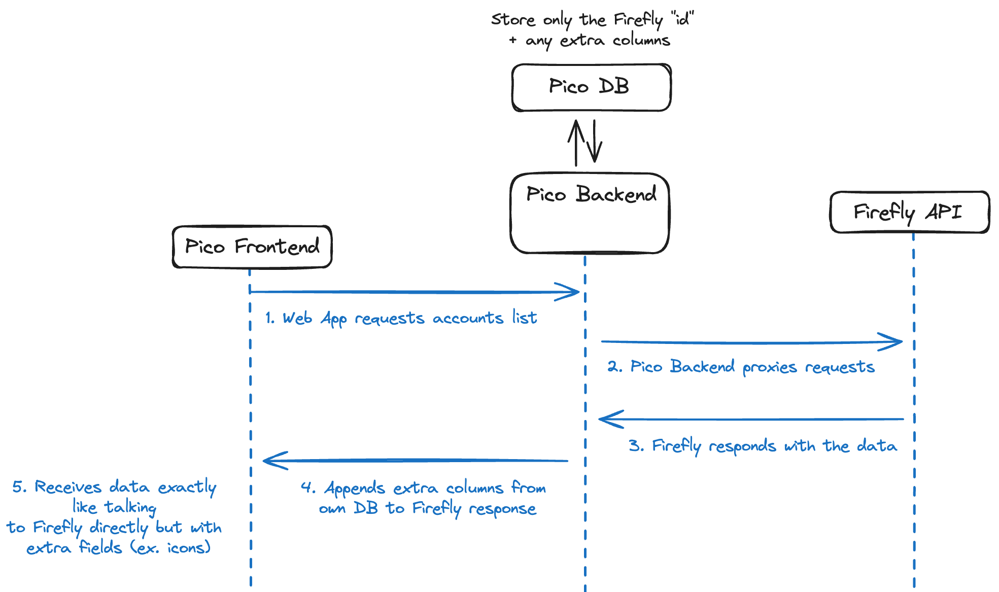

# Architecture

> Understand how Firefly Pico works under the hood.

## Frontend (The App)

Found inside the `/front` folder, it is a Single Page Application (SPA) built with:

- **Nuxt**: A powerful Vue.js framework that provides the application structure and routing.
- **Two interfaces**: a mobile app built on a home-grown UI kit that gives Pico its native app feel, and a dedicated desktop app. Pico picks one on startup based on your screen (or your choice in Settings).
- **Tailwind CSS** and **Pinia** for styling and state.
- **PWA** (Progressive Web App): Allows the app to be installed on your device, load offline, and launch like a native app.
- **iOS app** (inside `/ios`): a native wrapper around the same web app that adds native voice recording for [Ramble](/ramble).

## Backend (The Brains)

Found inside the `/back` folder it exposes a REST API and proxies all requests to your **Firefly III** instance.

- **Laravel**: A robust PHP framework used for the REST API.
- **Spatie Query Builder** for implementing the JSON:API specification

### Database

**Firefly-Pico** maintains a separate, lightweight database to store:

- **Icons:** Linked to Firefly resources (accounts, categories, tags, budgets etc).
- **Metadata:** Extra columns not supported by Firefly III (ex. parent **tags**, the todo **tag**).
- **Templates** and **Profiles** (settings synced via your token).
- **Rambles:** Saved texts and voice recordings waiting to be interpreted.
- **Assistant connections:** Each user's own LLM / transcription settings, with the API keys encrypted.

## Security

**Firefly-Pico** does not implement a separate authorization layer!

- It proxies all requests to the **Firefly III** API.
- **Firefly III** is responsible for checking the Authorization header.
- Even custom endpoints (like /api/transaction-templates) are authorized by against **Firefly III**'s `v1/about/user` endpoint first.
- **Benefit:** Single source of truth for authorization; no separate account needed.

### Data Storage

- **Local Storage:** App settings, tags, accounts, categories, budgets, and templates are cached in the browser's `localStorage` for instant access.
- **Syncing:** Data is re-synced every `N days` (configurable). You can manually trigger a sync via `Settings` -> `Sync everything` on mobile, the sync button in the sidebar on desktop, or by pulling to refresh on lists.

## Docker

- exposes a single port to the outside. Inside the container there is an Nginx instance which sends all requests containing `/api` to the backend and all other to the frontend instance.
- Pico's database is SQLite by default (inside the data volume), but PostgreSQL is also supported via the `DB_*` variables (see `docker-compose.pico.yml`).
- The data volume also keeps the generated `APP_KEY`, used to encrypt the assistant API keys.
